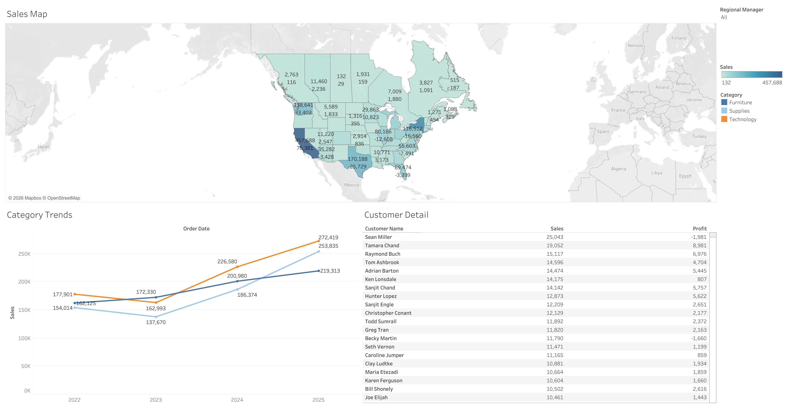

# Tableau Sales and Profitability Dashboard Review

**Author:** Cameron Batts

## Problem
Present regional sales, category trends and customer profitability with a clear distinction between source-data calculations and dashboard previews.

## Dashboard design and review
Review the static dashboard exports and independently aggregate the included Orders worksheet by region and calendar year. Check row IDs, date coverage, distinct orders and customers before comparing headline figures.

## Findings
The included Orders sheet contains 10,194 line items dated January 3, 2022–December 30, 2025, with 804 distinct customers and 5,111 distinct orders. Unfiltered totals are $2,326,534.35 in sales and $292,296.81 in profit (12.56% profit/sales). West leads regional sales at $739,813.61, followed by East at $691,828.17. Technology totals $272,419.17 for calendar year 2025; that figure is annual, not quarterly.

## Limitations
The executive preview and the included Orders spreadsheet use separate sources: the executive package embeds Sample - Superstore, while the sales package embeds Orders + Manager. The executive preview displays 2,703 customers, 6,455 orders, $8.952M sales and a 15% profit ratio; those exact KPI values and filter scope have not been independently recomputed from its extract. The map value near $457,688 is a state-level figure, not the West regional total. Packaged workbooks are now included and their definitions were inspected, but Tableau rendering, live actions, data refresh and embedded Hyper queries remain untested. Dataset provenance is not fully documented; filenames containing 2026 do not imply 2026 sales.

## Data and provenance
The Excel file contains Orders, Managers and Inventory worksheets. A separate traffic-accident CSV is bundled but is not used for the sales summaries. Source files remain unchanged.

## Verification
Analysis/verify_sales.py recomputed the included spreadsheet totals. Analysis/inspect_workbooks.py checked the two supplied Public packages, their XML definitions, formulas and declared actions. ZIP integrity checks passed for all four uploaded variants. Tableau itself was not opened or rerun. The Hyper query attempt was blocked by the local environment before any extract data was read.

## Reading the dashboard
The dashboard exports combine maps, annual category trends, customer tables and an executive KPI example. Read each export in its own filter and data context; use the source summaries for independently reproduced totals.

## View the project
- [Analysis report](Reports/tableau_sales_dashboard.html)
- [Portfolio analysis](https://cameron-batts.github.io/tableau_sales_dashboard.html)
- [Original export: Tableau_Sales_Dashboard.pdf](Reports/Tableau_Sales_Dashboard.pdf)
- [Original export: SS Dashboard.pdf](Reports/SS%20Dashboard.pdf)

## Dashboard previews



## Recompute source summaries
```bash
python -m pip install -r requirements.txt
python Analysis/verify_sales.py
```
Dependencies are unpinned. This recomputes source summaries; it does not recreate Tableau workbooks.

## Packaged workbooks
- [Sales and customer analytics](Workbooks/Sales-Customer-Analytics.twbx)
- [Executive sales metrics](Workbooks/Executive-Sales-Metrics.twbx)
- [Detailed workbook review](Reports/workbook_review.md)
- [Machine-readable definition review](Reports/workbook_definition_review.json)

The packages preserve the supplied workbook definitions and embedded sources. Portfolio review and documentation are by Cameron Batts; original source lineage remains intact.
